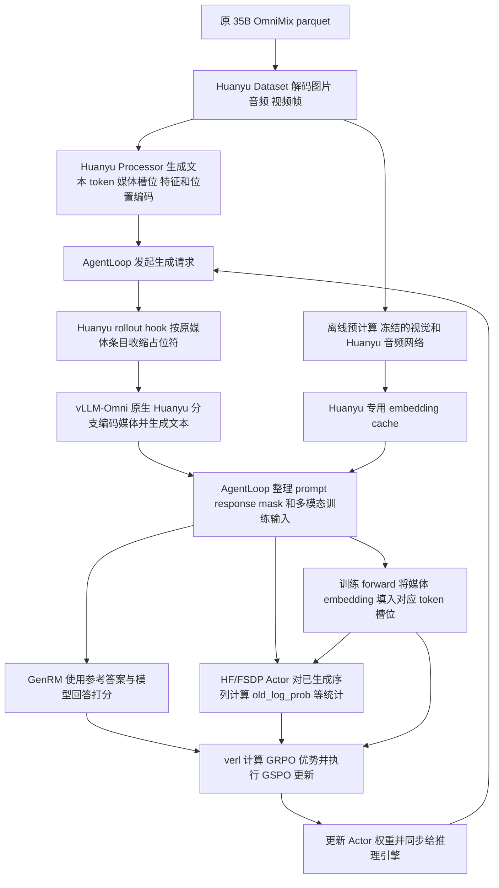

# Qwen3.6 Huanyu 训练适配与问题处理记录

历史记录日期：2026 年 10 月 20 日。

**2026-11-09：启动脚本已精简。本文保留当时模型、数据和排障证据，运行命令、路径与默认值请以[当前启动 Wiki](README.md)为准。** 原 `run_32card.sh`、`run_huanyu.sh` 等包装入口已移除，Huanyu适配参数并入最终GSPO后端；旧部署命令不能直接照搬。

当前奖励选择统一用 job 前的 `export HUANYU_REWARD_MODE=RM` 或 `rule_based`，显式值优先于旧的 `RM_ENABLE` / `STEM_REWARD_MODE`。本文的Actor16+GenRM16、评分方法和历史结果仍描述当时实验，不代表所有奖励模式的固定布局。

新增 AQA 在线音频解冻能力：同一 adapter 通过 `actor_rollout_ref.model.override_config.huanyu_freeze_audio` 支持冻结和解冻，默认仍冻结。新的部署命令、梯度链路及通信约束见 [AQA 在线编码与冻结／解冻训练](AQA_AUDIO_TRAINING_ZH.md)。下文的服务器运行记录仍描述此前冻结模式的实测结果。

本次工作把 Qwen3.6-Whisper 的 GSPO／GenRM 训练链路接入 Qwen3.6-Huanyu checkpoint，训练数据继续使用原来的 **35B OmniMix 数据集**。适配代码集中在 `verl_omni_ext/models/qwen3_6_huanyu/`，既负责训练侧接入，也负责训练与推理之间的数据接口。Huanyu 音频网络复用服务器已有的实现，文本主干、GenRM 打分和 GSPO 算法沿用现有链路。

服务器已经越过模型初始化和 rollout 接口错误，后续日志出现了训练指标，最近一次运行进度达到 **3/34870 步**，随后在计算 `old_log_prob` 的 entropy 时 OOM。对应的分块优化已实现并推送；截至本记录，尚未收到这项优化的服务器复测结果，不能将当前状态表述为全量训练已完成。

## 1. 任务范围与模型组成

### 1.1 当前使用的模型和数据

| 项目 | 本次配置 |
| --- | --- |
| Actor checkpoint | `/opt/huawei/dataset/downloaded_models/Qwen3.6-35B-A3B-huanyu06b-iter2000-omni4b-hf-huanyu7tokens` |
| 奖励模型 | `/opt/huawei/dataset/downloaded_models/Qwen3.5-35B-A3B` |
| 训练集 | `/opt/huawei/dataset/ccb_data/data/omni/omni_mix_f8_genrm_sampleall/train.parquet` |
| 验证集 | `/opt/huawei/dataset/ccb_data/data/omni/omni_mix_f8_genrm_sampleall/validation.parquet` |
| 数据规模 | train 111,614 行，validation 12,402 行，合计 124,016 行 |
| 排障期间的项目根目录 | `/opt/huawei/dataset/ccb_data/code/hufenyu/verl_omni_qwen36_gzq` |
| 选定的 vLLM-Omni 入口目录 | 历史曾使用 `/opt/huawei/dataset/infra_data/code/vllm-omni-xy-dbb-dev`；当前默认 `/vllm-workspace/vllm-omni` |
| 当前预计算缓存目录 | `/opt/huawei/dataset/infra_data/data/embed_cache_huanyu_sampleall_q128` |

这里的“35B 数据集”沿用任务中的命名，表示原训练流程使用的 OmniMix 产物；数据本身并不限定模型参数量。checkpoint 名称中的 `omni4b` 也不代表本次改为使用 OC-RL 的 4B 数据。此次没有重新执行 `omni_mix_4b.py`，没有改写已有 parquet。

### 1.2 为什么不能只改 MODEL_PATH

这个 checkpoint 的 HF 主体仍为 `Qwen3_5MoeForConditionalGeneration`，但音频部分已不同于 Whisper：

| 部分 | 当前 Huanyu checkpoint |
| --- | --- |
| 文本主干 | Qwen3.5-MoE 架构，hidden size 2048，词表 248320，含线性注意力和全注意力层 |
| 图像分支 | Qwen 视觉塔，merger 输出维度 2048 |
| 音频前端 | 16 kHz 单声道，40 维 fbank |
| 音频 encoder | VGG + 8 层 Conformer，hidden size 1536 |
| 音频时间下采样 | VGG `/4`，projector 前相邻两帧折叠再 `/2` |
| 音频 projector | `3072 → linear1 → ReLU → linear2 → 2048` |
| 音频权重前缀 | `model.audio_encoder.*`、`model.audio_projection.*` |

原 Whisper 适配器按 Whisper 的配置、网络和池化方式处理音频。只换 checkpoint 路径，仍然会选中旧 adapter，出现权重键和 projector 维度不匹配。另一方面，vLLM-Omni 能推理 Huanyu，并不自动让训练侧的 HF/FSDP 模型具备 Huanyu 音频网络及输入接口。

本次因此采取两层接入：**训练侧新增独立 Huanyu adapter；音频网络实现复用服务器 Huanyu 模块。** 不把 vLLM 推理引擎直接当作训练引擎使用。

## 2. 端到端链路



图中展示数据依赖；具体的打分与 log probability 计算可由训练器调度，并不表示它们必须按图的左右顺序串行执行。Actor 训练计算使用 rollout 已生成的序列做前向／反向，不重新生成一条回答。

缓存只替代训练侧冻结 encoder 的重复计算。推理侧仍接收原始图片、音频波形，并由 vLLM-Omni 处理；训练侧也仍需媒体预处理结果来确定槽位、网格和缓存键。

## 3. 具体新增了哪些适配

### 3.1 独立注册并明确选择 Huanyu 分支

[thinker_adapter.py](https://github.com/ZiqiGuan892/ext/blob/4b003b26321b7d5e35d14167666515a1d760a5b7/qwen3_6_huanyu/thinker_adapter.py) 注册了独立训练别名：

```python
@OmniModelBase.register("Qwen36HuanyuForTraining", stage="thinker")
class Qwen36HuanyuThinkerAdapter(OmniModelBase):
    ...
```

[最终 Huanyu GSPO 后端](run_qwen36_huanyu_gspo_npu.sh) 将选择分支所需的参数作为最终覆盖传入共享启动脚本：

```text
actor_rollout_ref.model.external_lib=verl_omni_ext.models.qwen3_6_huanyu
actor_rollout_ref.model.architecture=Qwen36HuanyuForTraining
actor_rollout_ref.model.model_stage=thinker
actor_rollout_ref.model.use_remove_padding=false
data.custom_cls.path=pkg://verl_omni_ext.models.qwen3_6_huanyu.dataset
data.custom_cls.name=Qwen36HuanyuOmniRLHFDataset
actor_rollout_ref.rollout.engine_kwargs.vllm_omni.pipeline_name=qwen3_6_huanyu
```

其中 `architecture` 是 verl-omni 的 adapter 选择别名，**没有把 checkpoint 中的 HF `architectures` 改成一个不存在的模型类**。这样不会覆盖 Whisper 或 RM 的注册项，也不需要修改公共 `pyproject.toml` 来注册该入口。

Huanyu 入口继续调用已有 32 卡、OmniMix + GenRM 和共享后端脚本，复用原有资源、采样和训练配置。资源口径仍为 actor/rollout pool 16 卡加 reward pool 16 卡；具体落在哪些物理节点，由 Ray 的资源安排决定。`PROJECT_ROOT` 显式选择副本；当前脚本有历史默认绝对路径，运行前应手工设置，见启动 Wiki。

### 3.2 复用原生音频网络并严格加载权重

[audio_runtime.py](https://github.com/ZiqiGuan892/ext/blob/4b003b26321b7d5e35d14167666515a1d760a5b7/qwen3_6_huanyu/audio_runtime.py) 复用以下服务器实现：

```text
vllm_omni/model_executor/models/minicpmo_5_0/huanyu_audio.py
    HuanyuFbankFeatureExtractor
    HuanyuAudioEncoder
    huanyu_project_and_fold

vllm_omni/model_executor/models/minicpmo_5_0/minicpmo_5_0_omni_llm.py
    MultiModalProjector
```

训练侧先加载 HF 主体，再在 FSDP 包装前挂载 `model.audio_encoder` 和 `model.audio_projection`。加载过程读取 checkpoint 的音频权重，核对全部键名和 shape，使用严格加载并实际物化参数；不通过 `strict=False`、补零或裁剪权重掩盖结构错误。模块名保留 checkpoint 的命名空间，便于保存和权重传输。

这里有两个容易混淆的维度：

- VGG 对 40 维频率轴做两次池化后得到 10，乘以 192 个通道，展平为 **1920**，再映射到 encoder hidden size 1536。
- projector 接收的是相邻两帧 encoder 输出的拼接，输入为 **1536 × 2 = 3072**，不是 1920。

默认路径中音频 encoder 和 projector 均冻结，并保持 eval。新增 `huanyu_freeze_audio=false` 后走独立的可微在线编码路径，两者都参与训练；当前解冻入口限定 AQA 音频数据。旧 `MINICPMO_TUNE_AUDIO=1` 不能替代这个正式超参数，配置矛盾会报错。冻结与缓存行为保持兼容。

为兼容 Actor 的 FP32 主参数与原生音频网络的混合精度，冻结音频前向使用临时 BF16 参数视图执行 `functional_call`，不原地改变 FSDP 主参数。VGG 保留原生 FP32 运算，Conformer 按原生 BF16 路径运行，RoPE 常量保留 FP32。若音频参数仍是未展开的分片，或子模块被单独 FSDP 包装，直接报出接口不满足，而不是临时触发只发生在部分 rank 上的集合通信。

### 3.3 接入真实的 40 维音频前端

[processor.py](https://github.com/ZiqiGuan892/ext/blob/4b003b26321b7d5e35d14167666515a1d760a5b7/qwen3_6_huanyu/processor.py) 的实际入口是 `build_huanyu_processor()`。它读取 `audio_preprocessor_config.json`，检查音频前端与 `audio_config` 一致，并组合：

1. checkpoint 自带 tokenizer；
2. Qwen 图像 processor；
3. 选定 vLLM-Omni 中的 Huanyu 40 维 fbank 提取器。

checkpoint 曾同时保留一份旧的 `processing_huanyu.py`，其内容按 128 维音频和旧 mel 文件编写。当前训练不走这份旧实现。[audio_frontend.py](https://github.com/ZiqiGuan892/ext/blob/4b003b26321b7d5e35d14167666515a1d760a5b7/qwen3_6_huanyu/audio_frontend.py) 和 `load_huanyu_processor()` 也只是保留的旧版检查组件，不能据其名字推断当前入口。

音频先按原始条目拆成不超过 30 秒的 chunk，再分别计算：

```text
真实帧数 F = (采样点数 L - 400) // 160 + 1
encoder 有效长度 = ceil(F / 4)
projector 有效 token 数 N = ceil(F / 4) // 2
```

例如 16 kHz 的 1 秒音频有 16,000 个采样点，得到 98 帧 fbank、25 帧有效 encoder 输出和 12 个最终音频 token。它对应的训练输入是：

```text
文本：请描述这段声音。
音频槽位：<|audio_start|> <unk> × 12 <|audio_end|>

fbank [40,98]
  → Huanyu encoder [25,1536]
  → 相邻两帧折叠并投影 [12,2048]
  → 替换 12 个 <unk> 位置的 embedding
```

padding 只用于运算对齐，不能把 padding 后的帧数当作有效 token 数。过短、无法形成一个 token 的 chunk 会明确报错，不静默丢弃尾部。

### 3.4 将媒体结果接入训练 forward

[dataset.py](https://github.com/ZiqiGuan892/ext/blob/4b003b26321b7d5e35d14167666515a1d760a5b7/qwen3_6_huanyu/dataset.py) 继续读取现有 parquet schema，支持图片路径／bytes、音频文件／bytes／zarr member，以及视频采帧。音频归一为 16 kHz 单声道；视频复用既有帧采样 helper，转为有序图片，是否提取视频音轨沿用对应开关。

Processor 把结构化消息整理成模型模板所需字符串，并展开媒体占位符。训练输入在原有 `input_ids`、mask、图像字段之外新增：

| 字段 | 作用 |
| --- | --- |
| `huanyu_audio_features` | 每个音频 chunk 的 40 维 fbank |
| `huanyu_audio_lengths` | 每个 chunk 未 padding 的真实帧数 |
| `huanyu_audio_bounds` | 音频 embedding 在当前 token 序列中的起止位置 |
| `huanyu_audio_chunk_counts` | 每条样本包含多少个 chunk，无音频样本也显式记录 0 |

[audio_alignment.py](https://github.com/ZiqiGuan892/ext/blob/4b003b26321b7d5e35d14167666515a1d760a5b7/qwen3_6_huanyu/audio_alignment.py) 和 [forward.py](https://github.com/ZiqiGuan892/ext/blob/4b003b26321b7d5e35d14167666515a1d760a5b7/qwen3_6_huanyu/forward.py) 根据实际 `input_ids` 验证媒体边界、长度和 batch 内归属，考虑左 padding 后的位置。随后在文本 embedding 输出处，把音频 embedding 填入对应槽位；文本位置保留原 embedding。图像在线模式沿用 HF 视觉路径，缓存模式则把缓存的视觉 embedding 填入图像槽位。

例如文本 embedding 为 `[B,S,2048]`，某音频对应区间 `[a,b)`，音频结果必须为 `[b-a,2048]`，才能替换该区间。这里是按序列位置替换，不是把音频向量拼到 hidden 维度上，也不是先把音频转成 ASR 文本。

对 AgentLoop，新增桥接使其在生成后能依据实际序列及 `multi_modal_data` 重建这些训练字段。桥接只对 `HuanyuProcessor` 生效，其他 processor 继续走原方法。

### 3.5 保留 Qwen 原生多模态 RoPE

图像需要三轴位置编码，不能把整个序列简单处理为一维 `0,1,2,...`。[processor.py](https://github.com/ZiqiGuan892/ext/blob/4b003b26321b7d5e35d14167666515a1d760a5b7/qwen3_6_huanyu/processor.py) 绑定安装版本的 `Qwen3_5MoeModel.get_rope_index()` 及其 helper，根据函数签名补齐需要的 `mm_token_type_ids`：

| token 类别 | 模态编号 |
| --- | --- |
| 文本、音频槽位、媒体边界标记 | 0 |
| 图像 patch token | 1 |
| 原生 video token | 2 |

当前 Dataset 把视频变成图片帧，因此该路径实际使用图像 token 和图像 grid。若遇到原生视频接口，则继续由安装版本的 Qwen 实现处理视频网格等规则。适配器没有重新编写一套近似 RoPE 算法。

### 3.6 连接训练占位符与推理输入

[rollout_adapter.py](https://github.com/ZiqiGuan892/ext/blob/4b003b26321b7d5e35d14167666515a1d760a5b7/qwen3_6_huanyu/rollout_adapter.py) 注册 `qwen3_6_huanyu`，复用现有单 `llm` stage 拓扑。底层 pipeline ID 仍为 `minicpmo_5_0_thinker_only`，模型 wrapper 根据 `audio_config.model_type=huanyu_conformer_0_6b` 选择 Huanyu 网络。

因此日志中仍可能出现 `minicpmo_5_0` 或被继承的 `qwen3_6_whisper/rollout_adapter.py` 路径。**这些名字本身不能证明实际使用 Whisper encoder**；应结合模型配置、严格加载日志和原生模块来源判断。训练注册的 `thinker` 与推理 stage 的 `llm` 也是两套接口的命名。

[rollout_inputs.py](https://github.com/ZiqiGuan892/ext/blob/4b003b26321b7d5e35d14167666515a1d760a5b7/qwen3_6_huanyu/rollout_inputs.py) 解决另一项差异：训练侧已经展开的媒体槽位，不能原样交给还会展开占位符的推理处理器，否则可能重复展开。Huanyu hook 根据原始媒体条目及 chunk 信息，把它们收缩回引擎需要的表示，再交给原生生成方法。

例如一条 31 秒音频在训练侧形成两个 chunk：30 秒约 375 个 token，1 秒约 12 个 token；对应两个音频槽位区间。但推理请求里仍是 **一条 31 秒波形**，不能误认为两条独立音频。hook 使用媒体元数据还原归属，不靠相邻标记猜测。

不同服务器版本的预处理位置不同，目前兼容同步 `_preprocess_input` 和内联预处理的异步 `generate`。对 Ray ActorClass 会找到实际 Python 类，只安装一个入口，保留请求 ID、媒体对象、采样参数和原始生成调用。

### 3.7 固定运行时来源并检查各节点

[runtime_imports.py](https://github.com/ZiqiGuan892/ext/blob/4b003b26321b7d5e35d14167666515a1d760a5b7/qwen3_6_huanyu/runtime_imports.py) 检查实际进程加载的包路径、Huanyu 文件及所需接口，并在失败时输出主机、PID、模块来源、包搜索路径、预期文件是否存在和 `PYTHONPATH`。

入口将 `HUANYU_VLLM_SOURCE` 和当前项目放到 `PYTHONPATH` 前面，并通过 Ray `runtime_env.env_vars` 显式传给新任务；`HUANYU_VLLM_OMNI_ROOT` 同步为所选目录，不再替换工作区中的 vLLM-Omni。所有节点需可读取同一路径、相同版本的源码。路径比较会解析符号链接。已导入另一份代码的进程会被拒绝，不在同一进程中拼接两个版本的 `sys.modules`。

这项检查不能替代节点部署：两个节点打印出同一个绝对路径，并不保证该路径下有相同文件。此次就实际出现过节点 0 有 `huanyu_audio.py`、节点 1 没有该文件的情况。

### 3.8 增加 Huanyu 专用缓存与并行预计算

[precompute.py](https://github.com/ZiqiGuan892/ext/blob/4b003b26321b7d5e35d14167666515a1d760a5b7/qwen3_6_huanyu/precompute.py) 只加载冻结的音频 encoder/projector 和视觉网络，保存投影／merger 后的 BF16 `[token数,2048]` embedding，不加载完整 35B 文本主干来做预计算。

[cache.py](https://github.com/ZiqiGuan892/ext/blob/4b003b26321b7d5e35d14167666515a1d760a5b7/qwen3_6_huanyu/cache.py) 为缓存记录模型和处理实现的契约：配置、权重分片信息、处理器／运行时代码等。媒体键基于处理后的特征和长度、图像 patch 和 grid 等内容，不单独依赖原媒体绝对路径。权重分片采用大小、mtime 和 header 哈希，不是全量权重字节哈希，所以模型目录应保持不可变。

训练启用方式为：

```bash
export MINICPMO_USE_PRECOMPUTE=0
export HUANYU_USE_PRECOMPUTE=1
export HUANYU_EMBED_CACHE_DIR=/opt/huawei/dataset/infra_data/data/embed_cache_huanyu_sampleall_q128
```

旧 Whisper cache 不兼容。启用 Huanyu cache 后，缺项、契约不一致、shape／dtype 错误或损坏均直接报错，不在某个 rank 上静默退回在线 encoder，避免各 rank 执行路径明显不一致。缓存模式要求视觉与音频冻结，当前不支持 DeepStack 视觉特征。

[precompute_parallel.py](https://github.com/ZiqiGuan892/ext/blob/4b003b26321b7d5e35d14167666515a1d760a5b7/qwen3_6_huanyu/precompute_parallel.py) 为每张选定 NPU 启动独立进程，按跨 train/validation 的连续全局行号取模分工，共用缓存目录。它不使用 Ray、DDP 或 HCCL；当前是单节点多卡入口。已有完整条目会校验后复用，失败后重跑仍扫描数据，但不重复编码已命中的条目。

缓存文件数不等于样本数：同一媒体可被多行重复引用，一条样本也可含多个媒体／chunk。完整性应通过遍历数据的 `--verify-only` 检查，而不是仅比较 `.pt` 文件数。

### 3.9 增加 Huanyu worker 的 entropy 分块

[entropy.py](https://github.com/ZiqiGuan892/ext/blob/4b003b26321b7d5e35d14167666515a1d760a5b7/qwen3_6_huanyu/entropy.py) 是最近增加的显存优化，由 Huanyu `configure_model()` 安装，覆盖该 worker 内 `verl.utils.torch_functional.entropy_from_logits`。公共 verl 文件没有修改；这里属于进程内函数替换，作用范围应理解为当前安装该补丁的 worker。

计算仍是完整词表熵：

\[
p_v=\operatorname{softmax}(z)_v,\qquad
H(z)=-\sum_v p_v\log p_v
=\operatorname{logsumexp}(z)-\sum_v p_v z_v.
\]

优化按 **token 轴每次最多 512 个位置**计算，每个位置仍覆盖全部 248,320 个词表项；没有改成 top-k 熵或采样估计。它避免一次生成全序列的概率／乘法中间张量，并避免对非连续的 `[B,S,V]` response 切片整体 flatten 成副本。

FP16／BF16／FP32 输入用 FP32 计算，FP64 保留 FP64。需要反向时，只保存原 logits 引用，按块重算概率并使用一阶梯度：

\[
\frac{\partial H}{\partial z_v}=p_v\left(\sum_j p_jz_j-z_v\right).
\]

这样不会为每块长期保存一份概率计算图，但完整 logits 和需要返回的完整梯度仍然存在。它针对这次 entropy 临时张量峰值，不代表所有后续 OOM 都会消失。该实现支持当前 RL 使用的一阶反向，不提供二阶导数。

## 4. 实际遇到的问题与处理过程

### 4.1 训练仍按 Whisper 网络加载 Huanyu 权重

**现象：** 大量 Huanyu encoder 权重被报为 unexpected，projector 出现 checkpoint `[2048,3072]` 与构造模块 `[2048,1024]` 不匹配。

**原因：** 只更换 `MODEL_PATH` 和推理后端，并未改变训练 adapter。训练端仍在构造 Whisper 网络；单独新增一个目录也不会自动改变注册选择。

**处理：** 新增独立训练别名、40 维 processor、严格音频加载和 forward，并由 Huanyu 启动入口显式指定 adapter、Dataset、rollout pipeline。后续服务器日志出现 `Loaded frozen audio encoder/projector strictly: 290/4 tensors; features=40`，已越过该加载故障。

### 4.2 主进程或某个节点找不到 huanyu_audio

**现象：** `ModuleNotFoundError: ...minicpmo_5_0.huanyu_audio`。第一次检查曾发现实际导入旧的 `/opt/huawei/dataset/ccb_data/code/hufenyu/vllm-omni-xy`；后来又出现节点 0 检查成功、节点 1 失败。

**原因：** 这类错误有两层：Python 可能选错代码目录；即便目录正确，各节点的挂载／代码内容也可能不同。节点 1 的诊断明确打印 `expected_native_file=.../huanyu_audio.py exists=False`，证明该次失败是文件缺失，不能继续归咎于同名 `PYTHONPATH`。

**处理：** 固定导入路径并传入 Ray job，增加逐进程来源检查；用户将两个节点更新为完整 Huanyu 版本后报告检查通过。需要同步的是包含 processor 分派、模型构造等内容的整套兼容版本，不能只向旧仓库补一个同名文件。

### 4.3 rollout hook 假定存在 _preprocess_input

**现象：** 初始化时 `vLLMOmniHttpServer has no attribute '_preprocess_input'`。

**原因：** 本地所见 server API 与实际服务器版本不同，或者导出的是 Ray 包装类。旧 hook 对接口作了过强假设，错误发生在生成前。

**处理：** 识别 Ray 的实际类，并支持同步独立预处理入口和异步 `generate` 入口；检查签名后再安装，保持重复安装幂等。后续日志进入 `generate`，说明不再停留在 hook 安装阶段。

### 4.4 AR 模式检查误拒绝正常生成

**现象：** 已进入 AgentLoop 的 `generate`，却被 `Huanyu rollout requires the autoregressive server mode` 拦截。

**原因：** 服务器使用 `ARStrategy`／`DiffusionStrategy` 分派，源码没有旧版 `_ar_mode` 属性。把“属性不存在”当成 False，错误拒绝了实际配置为 `output_mode=ar` 的请求。

**处理：** 兼容新旧表示；旧字段缺失时核对显式 engine 配置。没有可信配置、明确非 AR 或配置冲突时仍报错，不无条件放行。后续运行已越过该检查并产生 rollout。

### 4.5 AgentLoop 后处理缺少 mm_token_type_ids

**现象：** `Qwen3_5MoeModel.get_rope_index() missing 1 required positional argument: 'mm_token_type_ids'`，位于 AgentLoop 生成后的 `_compute_position_ids`。

**原因：** 安装版本的 Qwen RoPE API 要求显式模态标记，Huanyu processor 桥接没有传入。调用栈中的 `_compute_score` 不代表这次是 RM 网络失败，真正抛错点是位置编码接口。

**处理：** 根据实际 token ID 构造 text=0、image=1、video=2，并继续调用安装版本的原生 RoPE。用户先前误贴的 Python 3.11 实现不作为依据，后续以训练环境 Python 3.12 的真实源码核对。音频槽位使用连续位置，图像保留三轴位置。

### 4.6 关闭长度预筛后仍遇到 prompt 超长

**现象：** 展开后的请求为 3107 token，超过 rollout prompt 上限 3104；共享脚本 DEBUG 分支还可能重设长度。

**原因：** 关闭 `filter_overlong_prompts` 只是跳过 Dataset 构建阶段的预筛，不取消后续上下文上限。媒体占位符展开后也会增加序列长度。

**处理：** Huanyu 入口保留 `data.filter_overlong_prompts=false`，同时统一长度预算，先保存环境变量，再用最终 Hydra 参数覆盖共享脚本的 DEBUG 默认值。目前默认 data/rollout prompt 4096、response 2048、model/token budget 6272，并检查预算关系。

4096 能容纳这次 3107-token 请求，但不能据此保证全量未预筛数据均不超长。需要更长 response 时应同时增加 model/token budget；当前不会为了通过检查而截断媒体槽位。

### 4.7 old_log_prob 阶段出现 HCCL AllGather 超时

**现象：** `_compute_old_log_prob` 阶段，某 rank 等待 peer rank 的 AllGather notify 300 秒超时，之后 watchdog 终止进程，Ray 报 `ActorDiedError`。日志中还有更早的 stream allocator 异常信息。

**判断：** 能确认的是参与者未及时完成集合通信。它可能是某 rank 的前置计算、进程／设备异常或其他同步问题的后果；这份日志不能证明“没有预计算 cache”就是根因，也不能单凭最后一条超时认定网络故障。

**处理：** 增加冻结音频和视觉的离线缓存，减少训练时重复编码，并在 cache 模式禁止局部 miss 后静默在线计算。该改动可减少计算耗时和 rank 间执行差异，但不是对所有 HCCL 超时的通用修复。是否消除该次超时，需要同环境复测及各 rank 更早日志确认。

### 4.8 缓存创建时硬链接被文件系统拒绝

**现象：** `cache.py → _publish → os.link(temporary, manifest.json)` 抛出 `PermissionError: [Errno 1] Operation not permitted`。

**原因：** 临时文件创建、写入和 fsync 已成功，失败的是挂载不支持／不允许的硬链接操作；不能把它概括为目录完全没有写权限。此时还没有开始样本编码。

**处理：** 改为同目录临时文件、目录锁和 rename 发布，保留已有文件校验及异常清理，避免覆盖不一致目标。后续日志已进入 `mode=populate` 并创建缓存条目，说明原来的 manifest 发布阻塞已跨过。并发进程需使用同一发布协议，强杀后的残留锁仍须按运行说明处理。

### 4.9 预计算大图时视觉 attention OOM

**现象：** `train.parquet row 8`，即第 9 条样本，在视觉 `eager_attention_forward` 的 `query @ key.T` 申请 31.13 GiB，设备当时只剩 24.31 GiB。

**原因：** 大图 patch 多，完整 attention score 矩阵随 token 数平方增长。这次失败位于 Qwen 视觉网络，音频 `290/4` 权重已严格加载；不是 Huanyu 音频结构错，也不是预计算加载了整个 35B 文本主干。

**处理：** [vision_attention.py](https://github.com/ZiqiGuan892/ext/blob/4b003b26321b7d5e35d14167666515a1d760a5b7/qwen3_6_huanyu/vision_attention.py) 在预计算视觉前向期间按 query 轴每 128 个位置分块，保持完整 K/V 和原有帧边界。它不降低图像分辨率，不改变媒体 token 数，并要求 eval、no_grad、非因果且 dropout=0；实际 hook 未命中时拒绝保存结果。

数学上仍是原来的完整 attention，但不同 GEMM 形状可能带来数值舍入差异，因此新缓存使用 `single_image_hf_bf16_eager_q128_v1` 契约和 `_q128` 目录，不与旧结果混用。用户后续反馈预计算已经能正常运行；分块降低峰值显存，不减少 attention 的平方计算量，所以仍可能耗时较长。

### 4.10 单卡预计算速度不足

**现象：** 正常编码后，124,016 行的单卡处理耗时较长。

**处理：** 新增多进程多 NPU 分片入口，每张卡独立处理样本，并在导入原生插件前绑定设备，避免初始化都落到默认卡。所有 worker 完成、退出码及分配行数校验通过后才汇总为 `COMPLETE`，任一失败会结束本次启动的其他子进程。

用户提供的 16 卡日志中，每个 worker 分到 7751 行，合计 124,016；总处理量从 614、746、929 增至 1072，`failed=0`，说明当时各 worker 正在推进。它不是全量完成证明，最终仍需 `COMPLETE` 和完整性校验。共享存储和 CPU 前处理可能限制加速比例。

### 4.11 old_log_prob 的 entropy 临时张量 OOM

**现象：** 训练进度到 3/34870，调用链为：

```text
_compute_old_log_prob
  → actor_rollout_compute_log_prob
  → infer_batch(forward_only=True)
  → prepare_model_outputs
  → verl_F.entropy_from_logits(logits)
  → OOM
```

日志显示 NPU 已分配约 48.37 GiB、PyTorch 保留约 48.41 GiB、空闲 9.36 GiB，函数再申请 9.58 GiB 失败。allocated 与 reserved 接近，这份证据主要指向计算临时张量峰值，而非典型的大量空闲 reserved 碎片。

**原因：** 实际调用仍进入普通全量 entropy 函数。配置虽然有 `entropy_coeff=0`、`entropy_from_logits_with_chunking=true` 和 512 的 chunk size，但没有阻止这条路径调用未分块工具函数。熵正则系数为零，不等于 old_log_prob 阶段不统计熵。

原 Whisper forward builder 还安装了额外 entropy 补丁；独立 Huanyu adapter 没有调用包含 Whisper 音频/cache 行为的整个 builder，因此没有继承这项保护。仅凭日志不能进一步断言服务器 engine 的分块配置为何未覆盖该入口。

**处理：** 在 Huanyu 目录新增第 3.9 节的 `entropy.py`，由 Huanyu 模型配置入口安装，针对实际被调用的函数进行 token 分块。首次安装及首次调用分别输出：

```text
[huanyu-entropy] installed ... chunk_size=512 target=verl.utils.torch_functional.entropy_from_logits
[huanyu-entropy] active ... shape=(...) dtype=... device=... chunk_size=512 ...
```

这次调用栈不在 Huanyu encoder、`loss.backward()` 或 RM 内；无需因为这个 entropy 修改重算媒体 cache。补丁已发布到 [Huanyu 专用分支的 48963c5 提交](https://github.com/ZiqiGuan892/ext/commit/48963c54156b135c777d45871b9d546dc6ef82d7)，服务器是否不再出现该 OOM 尚待重跑。

## 5. 当前验证结果与剩余边界

| 项目 | 已获得的证据 | 不能据此推出的结论 |
| --- | --- | --- |
| 两节点运行时 | 用户更新两节点后报告导入检查通过 | 之后每次部署都自动保持一致 |
| Huanyu 音频加载 | 严格加载 290 个 encoder 张量、4 个 projector 张量，features=40 | 所有模态数值均已与 SFT 基线逐项验收 |
| rollout 与训练接入 | 后续有 rollout、GenRM 和训练指标，进度达到 3 步 | 全量数据、全部模态都已覆盖，训练已经收敛 |
| 预计算 | 用户确认可正常运行；16 卡日志显示全部 worker 有进度 | 124,016 行已全部完成且 cache 无缺项 |
| entropy 优化 | 最近一次完整 Huanyu CPU 回归 200 项通过，补丁已推送 | 真实 NPU OOM 已消失 |

最近一次代码回归命令为：

```bash
python -B -m unittest discover \
  -s verl_omni_ext/models/qwen3_6_huanyu/tests \
  -p 'test_*_on_cpu.py' -q
```

这 200 项覆盖输入与权重契约、占位符和 batch 对齐、RoPE 接口、server hook、缓存读写／并发／损坏拒绝、视觉分块、并行分片，以及 entropy 值和一阶梯度。entropy 新增测试包括 FP16/BF16/FP32/FP64、FP64 gradcheck、非连续 response 切片及前反向分块上限。CPU 测试不能替代真实 checkpoint 的 NPU 数值和分布式验收。

后续服务器验收应先确认 `[huanyu-entropy] active` 已出现，再观察相同 old_log_prob 阶段是否通过。缓存用全量 `--verify-only` 核查；音频另外用短音频、跨 30 秒音频和音视频样本对照训练／推理 token 数及数值。若再次遇到超时，保留所有 rank 的首个异常，而不是只根据末尾 Ray/HCCL 包装错误定位。

## 6. 代码与运行说明索引

| 内容 | 入口 |
| --- | --- |
| 模型注册和配置 | [thinker_adapter.py](https://github.com/ZiqiGuan892/ext/blob/4b003b26321b7d5e35d14167666515a1d760a5b7/qwen3_6_huanyu/thinker_adapter.py)、[rollout_adapter.py](https://github.com/ZiqiGuan892/ext/blob/4b003b26321b7d5e35d14167666515a1d760a5b7/qwen3_6_huanyu/rollout_adapter.py) |
| 原生依赖来源检查 | [runtime_imports.py](https://github.com/ZiqiGuan892/ext/blob/4b003b26321b7d5e35d14167666515a1d760a5b7/qwen3_6_huanyu/runtime_imports.py)，当前执行 `python3 -B .../runtime_imports.py --check`；旧 `check_runtime.py` 入口已移除 |
| 数据与处理器 | [dataset.py](https://github.com/ZiqiGuan892/ext/blob/4b003b26321b7d5e35d14167666515a1d760a5b7/qwen3_6_huanyu/dataset.py)、[processor.py](https://github.com/ZiqiGuan892/ext/blob/4b003b26321b7d5e35d14167666515a1d760a5b7/qwen3_6_huanyu/processor.py) |
| 音频权重、执行与对齐 | [audio_runtime.py](https://github.com/ZiqiGuan892/ext/blob/4b003b26321b7d5e35d14167666515a1d760a5b7/qwen3_6_huanyu/audio_runtime.py)、[audio_weights.py](https://github.com/ZiqiGuan892/ext/blob/4b003b26321b7d5e35d14167666515a1d760a5b7/qwen3_6_huanyu/audio_weights.py)、[audio_alignment.py](https://github.com/ZiqiGuan892/ext/blob/4b003b26321b7d5e35d14167666515a1d760a5b7/qwen3_6_huanyu/audio_alignment.py) |
| 训练和推理接口 | [forward.py](https://github.com/ZiqiGuan892/ext/blob/4b003b26321b7d5e35d14167666515a1d760a5b7/qwen3_6_huanyu/forward.py)、[rollout_inputs.py](https://github.com/ZiqiGuan892/ext/blob/4b003b26321b7d5e35d14167666515a1d760a5b7/qwen3_6_huanyu/rollout_inputs.py) |
| 缓存与预计算 | [cache.py](https://github.com/ZiqiGuan892/ext/blob/4b003b26321b7d5e35d14167666515a1d760a5b7/qwen3_6_huanyu/cache.py)、[precompute.py](https://github.com/ZiqiGuan892/ext/blob/4b003b26321b7d5e35d14167666515a1d760a5b7/qwen3_6_huanyu/precompute.py)、[precompute_parallel.py](https://github.com/ZiqiGuan892/ext/blob/4b003b26321b7d5e35d14167666515a1d760a5b7/qwen3_6_huanyu/precompute_parallel.py) |
| 显存优化 | [vision_attention.py](https://github.com/ZiqiGuan892/ext/blob/4b003b26321b7d5e35d14167666515a1d760a5b7/qwen3_6_huanyu/vision_attention.py)、[entropy.py](https://github.com/ZiqiGuan892/ext/blob/4b003b26321b7d5e35d14167666515a1d760a5b7/qwen3_6_huanyu/entropy.py) |
| Huanyu 启动入口 | [最终 Huanyu GSPO 后端](run_qwen36_huanyu_gspo_npu.sh) |
| 完整运行命令与历史细节 | [README.md](README.md) |

Huanyu 专用发布分支只打包 `qwen3_6_huanyu/` 文件夹。它仍依赖现有 ext 公共组件、共享启动后端以及兼容的 verl、verl-omni、vLLM-Omni；“独立文件夹”表示改动和分支内容受限，不表示它是一套脱离这些依赖的完整训练框架。
